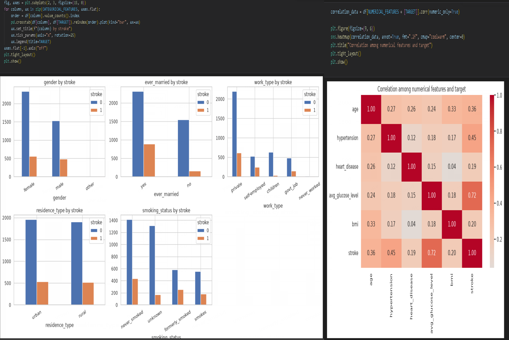
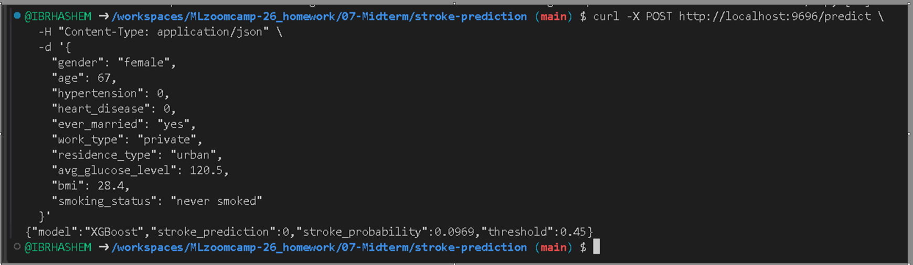
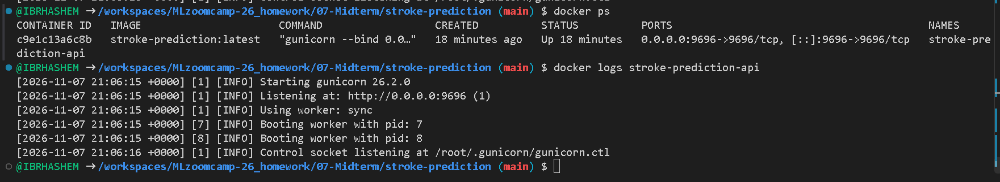

# Stroke Prediction — Machine Learning Midterm Project

**Machine Learning Zoomcamp 2026**

## 1. Project Overview

This project builds an end-to-end machine learning classification application that estimates the probability of stroke based on demographic information and health-related indicators.

The project covers the main stages of a practical machine learning workflow:

- Exploratory Data Analysis (EDA).
- Data cleaning and preprocessing.
- Feature engineering and encoding.
- Training and comparing classification models.
- Hyperparameter tuning.
- Model selection using validation ROC AUC.
- Decision-threshold optimization using validation F1 score.
- Final evaluation on a held-out test set.
- Model serialization and reload verification.
- A Flask web application and REST API.
- Docker containerization.
- Public demo access through GitHub Codespaces port forwarding.

> **Important:** This is an educational machine learning project. It is not a medical device and must not be used for diagnosis, clinical screening, treatment decisions, or emergency decision-making.

## 2. Problem Definition

### Problem

Stroke is a serious health condition, and identifying patterns associated with stroke records is a useful machine learning classification exercise. The goal of this project is to build a model that uses available patient attributes to estimate whether a record belongs to the positive stroke class.

The target variable is `stroke`:

- `0`: No stroke recorded.
- `1`: Stroke recorded.

### Project Objectives

1. Explore the available patient data and understand its features.
2. Prepare the data for machine learning, including handling missing values.
3. Train and compare several classification algorithms.
4. select a model using validation performance.
5. Choose a decision threshold based on validation F1 score.
6. Evaluate the final model on data kept separate from training and model selection.
7. make the trained model available through a simple web interface and JSON API.

### Proposed Solution

The project uses a supervised binary-classification workflow. It evaluates Logistic Regression, Decision Tree, Random Forest, and XGBoost, then selects the candidate with the strongest validation ROC AUC. A separate validation-based threshold is used to convert predicted probabilities into class predictions.

The selected model and its preprocessing information are saved together so the prediction application can apply the same transformations to incoming patient data.

### Expected System

The delivered application provides:

- A browser-based form for entering patient attributes.
- A JSON endpoint for programmatic predictions.
- A predicted stroke probability and a class prediction based on the selected threshold.
- A health-check endpoint to verify that the application is running.

The output is a model estimate based on this dataset, not a clinical assessment or recommendation.

## 3. Dataset

The project uses a manipulated version of the Stroke Prediction dataset.

| Dataset property | Value |
|---|---:|
| Records | 4,909 |
| Columns | 12 |
| Target | `stroke` |

**Dataset filename:** `healthcare-dataset-stroke-data_manipulated.csv`

The dataset is available in the `07-Midterm` directory, with a copy inside the `stroke-prediction` project directory.

### Features

| Feature | Description |
|---|---|
| `gender` | Patient gender |
| `age` | Patient age |
| `hypertension` | Hypertension indicator |
| `heart_disease` | Heart disease indicator |
| `ever_married` | Marital status |
| `work_type` | Type of employment |
| `Residence_type` | Urban or rural residence in the source dataset |
| `avg_glucose_level` | Average glucose level |
| `bmi` | Body Mass Index |
| `smoking_status` | Smoking category |
| `id` | Record identifier; excluded from model predictors |
| `stroke` | Target variable |

The training pipeline normalizes column names to lowercase and replaces spaces with underscores. Therefore, the API field corresponding to the source column `Residence_type` is **`residence_type`**.

**Dataset note:** The supplied dataset is a manipulated version used for this educational project. Its class distribution should not be interpreted as the real-world prevalence of stroke.

## 4. Machine Learning Workflow

The project follows a structured workflow:

1. Load and inspect the dataset.
2. Check data quality and missing values.
3. Explore the target and predictor distributions.
4. Perform exploratory data analysis.
5. Split the data into training, validation, and test sets using stratification.
6. Calculate imputation values from the training data.
7. Apply the BMI upper cap of 60.
8. Encode the input features using `DictVectorizer`.
9. Train candidate classification models.
10. Tune hyperparameters for Decision Tree, Random Forest, and XGBoost.
11. Compare models using validation ROC AUC.
12. Select the best-performing candidate.
13. Optimize the classification threshold using validation F1 score.
14. Evaluate the selected model on the held-out test set.
15. Save the estimator, fitted vectorizer, threshold, and preprocessing metadata.
16. Reload the saved package and verify prediction consistency.
17. Serve predictions through Flask.
18. Build and run the application in Docker.

### Data Split

The data is divided using stratified splitting with `random_state=42`.

| Dataset | Share |
|---|---:|
| Training | 60% |
| Validation | 20% |
| Test | 20% |

The test set is reserved for final evaluation. It is not used for model selection or threshold optimization.

### Preprocessing

- Missing numerical values are imputed using statistics calculated from the training set.
- Missing categorical values are imputed using the training-set categorical modes.
- BMI values are capped at an upper limit of 60.
- Categorical values are normalized before encoding.
- `DictVectorizer` transforms the feature dictionaries into model-ready vectors.
- The `id` column is excluded from the predictors.

## 5. Models Evaluated

The following classification algorithms were evaluated:

- Logistic Regression
- Decision Tree
- Random Forest
- XGBoost

Hyperparameter tuning was performed for Decision Tree, Random Forest, and XGBoost. Logistic Regression was included as a baseline.

### Validation ROC AUC

| Model | Validation ROC AUC |
|---|---:|
| XGBoost | 0.9837 |
| Random Forest | 0.9831 |
| Decision Tree | 0.9779 |
| Logistic Regression | 0.9715 |

**Selected model: XGBoost**

The final candidate was selected based on validation ROC AUC.

## 6. Decision Threshold Optimization

A probability threshold of **0.45** was selected using the validation set by maximizing the F1 score.

| Metric | Validation result |
|---|---:|
| Threshold | 0.45 |
| Precision | 0.984 |
| Recall | 0.895 |
| F1 Score | 0.938 |

The threshold determines how predicted probabilities are converted into class labels. It was selected using validation data and then kept fixed for the final test evaluation.

## 7. Final Model Performance

The selected XGBoost model was evaluated on the held-out test dataset using the selected threshold.

| Metric | Test result |
|---|---:|
| ROC AUC | 0.9898 |
| Accuracy | 0.9807 |
| Precision | 0.9657 |
| Recall | 0.9426 |
| F1 Score | 0.9540 |
| Decision Threshold | 0.450 |

These results describe this project's specific test split only. They do not establish clinical effectiveness or guarantee performance on other datasets or populations.

## 8. Project Screenshots

### Exploratory Data Analysis



### Prediction Web Interface – Live Test



The screenshot demonstrates a successful prediction through the running web application. The application URL shown in the browser indicates access to the running interface; it should not be interpreted as proof of a separate cloud deployment.

### Docker Container



## 9. Project Structure

```text
MLzoomcamp-26_homework/
│
└── 07-Midterm/
    │
    ├── healthcare-dataset-stroke-data_manipulated.csv
    │
    └── stroke-prediction/
        │
        ├── notebook.ipynb
        ├── train.py
        ├── predict.py
        ├── stroke_prediction_model.bin
        ├── healthcare-dataset-stroke-data_manipulated.csv
        ├── requirements.txt
        ├── Dockerfile
        ├── README.md
        ├── templates/
        │   └── index.html
        ├── static/
        │   └── style.css
        └── screenshots/
            ├── 01-eda-analysis.png
            ├── 02-api-prediction.png
            └── 03-docker-container.png
```

### Main Files

| File | Purpose |
|---|---|
| `notebook.ipynb` | Exploratory analysis, experiments, and evaluation |
| `train.py` | Data preparation, model training, evaluation, and serialization |
| `predict.py` | Flask application, preprocessing for incoming requests, and prediction endpoints |
| `stroke_prediction_model.bin` | Serialized model package and preprocessing metadata |
| `templates/index.html` | Web application interface |
| `static/style.css` | Web interface styling |
| `requirements.txt` | Python dependencies |
| `Dockerfile` | Docker image configuration |
| `screenshots/` | Project screenshots |

## 10. Technologies Used

- Python
- Pandas
- NumPy
- Scikit-learn
- XGBoost
- Matplotlib
- Seaborn
- Flask
- Gunicorn
- Docker
- Jupyter Notebook
- GitHub Codespaces

## 11. Environment Setup

### Prerequisites

- Python 3.14 (the project dependencies are pinned in `requirements.txt`).
- pip (included with standard Python installations).
- Docker, if you want to run the containerized application.
- GitHub Codespaces or a local development environment.

### 1. Clone the Repository

If you have not cloned the repository yet:

```bash
git clone https://github.com/IBRHASHEM/MLzoomcamp-26_homework.git
cd MLzoomcamp-26_homework/07-Midterm/stroke-prediction
```

### 2. Create a Virtual Environment

Create an isolated Python environment in the project directory:

```bash
python -m venv .venv
```

### 3. Activate the Virtual Environment

**Windows — PowerShell:**

```powershell
.venv\\Scripts\\Activate.ps1
```

If PowerShell blocks script execution, allow activation for the current terminal session only:

```powershell
Set-ExecutionPolicy -ExecutionPolicy RemoteSigned -Scope Process
.venv\\Scripts\\Activate.ps1
```

**Windows — Command Prompt (CMD):**

```cmd
.venv\\Scripts\\activate.bat
```

**Linux / macOS / GitHub Codespaces:**

```bash
source .venv/bin/activate
```

When the environment is active, its name (usually `.venv`) appears at the beginning of your terminal prompt.

### 4. Install Dependencies

With the virtual environment activated, upgrade pip and install the pinned project dependencies:

```bash
python -m pip install --upgrade pip
python -m pip install -r requirements.txt
```

### 5. Verify the Environment

Check that Python and the required packages are available:

```bash
python --version
python -m pip list
```

### 6. Deactivate the Virtual Environment

When you have finished working on the project:

```bash
deactivate
```

> **Note:** Activate the virtual environment before running the training script or the Flask application. You need to create the environment and install dependencies only once; on later sessions, open the project directory, activate `.venv`, and continue working.

## 12. Training the Model

The training script reads the dataset from the parent `07-Midterm` directory.

From the `stroke-prediction` directory, run:

```bash
python train.py
```

The script prepares the data, trains and compares the models, selects the best candidate using validation ROC AUC, chooses a threshold using validation F1, evaluates the selected model on the test set, and saves the model package.

The output file is:

```text
stroke_prediction_model.bin
```

## 13. Running the Application Locally

From the `stroke-prediction` directory, run:

```bash
python predict.py
```

The Flask application listens on port `9696`.

Open the web interface:

```text
http://localhost:9696/
```

### Application Endpoints

| Method | Endpoint | Purpose |
|---|---|---|
| GET | `/` | Web prediction interface |
| GET | `/healthz` | Application health check |
| POST | `/predict-form` | Prediction submitted from the web form |
| POST | `/predict` | JSON prediction API |

## 14. Running the Application with Docker

The Docker image runs the Flask application using Gunicorn. The container listens on port `9696`.

### Build the Image

From the `stroke-prediction` directory:

```bash
docker build -t stroke-prediction:latest .
```

### Run the Container

```bash
docker run -d \\
  --name stroke-prediction-api \\
  -p 9696:9696 \\
  stroke-prediction:latest
```

### Check the Container

```bash
docker ps
docker logs stroke-prediction-api
```

### Test the Health Endpoint

```bash
curl http://localhost:9696/healthz
```

### Stop and Remove the Container

```bash
docker stop stroke-prediction-api
docker rm stroke-prediction-api
```

If the container name is already in use, stop and remove the existing container before creating another one.

## 15. Public Demo Deployment — GitHub Codespaces

The application was successfully exposed to the internet using GitHub Codespaces port forwarding. The Flask application runs inside a Docker container, and Codespaces forwards a public HTTPS address to the container port.

**Live demo:** [Open the Stroke Prediction Web Application](https://glorious-space-waddle-4jr7r5q4jw5rhqjrq-9697.app.github.dev/)

**Health check:** [Check API health](https://glorious-space-waddle-4jr7r5q4jw5rhqjrq-9697.app.github.dev/healthz)

### Deployment Configuration

| Component | Configuration |
|---|---|
| Development and hosting environment | GitHub Codespaces |
| Container | Docker |
| Application server | Flask with Gunicorn |
| Container listening port | `9696` |
| Forwarded Codespaces port | `9697` |
| Port visibility | Public |
| Public protocol | HTTPS |

### Deployment Verification

The public health-check endpoint returned HTTP 200 with:

```json
{
  "model": "XGBoost",
  "status": "healthy"
}
```

The public JSON prediction endpoint was also tested successfully using an external HTTPS request to `/predict`. The response was HTTP 200:

```json
{
  "model": "XGBoost",
  "stroke_prediction": 1,
  "stroke_probability": 0.9906,
  "threshold": 0.45
}
```

This confirms that both the health-check and prediction endpoints were reachable through the public Codespaces URL at the time of testing.

> **Availability and security note:** This is a temporary demonstration deployment, not a permanent production hosting service. The Codespace must remain running, and the forwarded port must remain publicly accessible. Public port forwarding makes the application reachable by anyone who has the URL. Do not submit real patient or other sensitive personal data to this demo. The sample prediction above is for software testing only and is not a medical assessment.

## 16. Static Frontend — GitHub Pages

The browser interface is also available as a static website deployed through GitHub Pages. The static frontend is stored in `frontend/` and communicates with the Flask prediction API over HTTPS.

**GitHub Pages URL:** https://ibrhashem.github.io/MLzoomcamp-26_homework/

The frontend deployment is automated by `.github/workflows/deploy-stroke-pages.yml`. A push that changes the frontend files triggers the deployment workflow.

**Architecture:**
- GitHub Pages hosts the static HTML, CSS, and JavaScript interface.
- The existing Flask API continues to load and run the trained XGBoost model.
- The frontend sends JSON requests to the Codespaces API endpoint.
- The API allows browser requests from the GitHub Pages origin through a restricted CORS policy.

**Important:** GitHub Pages does not host or execute the Python API or model. The Codespaces API must remain running and its forwarded port must remain public for predictions to work. The Pages website may load while predictions are unavailable if the Codespace is stopped.

Before the first deployment, enable GitHub Pages in the repository settings and select **GitHub Actions** as the deployment source.

## 17. API Usage

The JSON prediction endpoint accepts a `POST` request at:

```text
http://localhost:9696/predict
```

### Example JSON Request

Use lowercase field names, including `residence_type`:

```json
{
  "gender": "female",
  "age": 67,
  "hypertension": 0,
  "heart_disease": 0,
  "ever_married": "yes",
  "work_type": "private",
  "residence_type": "urban",
  "avg_glucose_level": 120.5,
  "bmi": 28.4,
  "smoking_status": "never smoked"
}
```

### Example API Response

```json
{
  "model": "XGBoost",
  "stroke_prediction": 0,
  "stroke_probability": 0.0969,
  "threshold": 0.45
}
```

### Test with cURL

```bash
curl -X POST http://localhost:9696/predict \\
  -H "Content-Type: application/json" \\
  -d '{
    "gender": "female",
    "age": 67,
    "hypertension": 0,
    "heart_disease": 0,
    "ever_married": "yes",
    "work_type": "private",
    "residence_type": "urban",
    "avg_glucose_level": 120.5,
    "bmi": 28.4,
    "smoking_status": "never smoked"
  }'
```

### Response Fields

| Field | Description |
|---|---|
| `model` | Selected machine learning model |
| `stroke_prediction` | Predicted class: 0 or 1 |
| `stroke_probability` | Estimated probability of the positive class |
| `threshold` | Decision threshold used to determine the predicted class |

## 18. Reproducibility

To reproduce the workflow:

1. Clone the repository.
2. Ensure the dataset is available at the expected relative path.
3. Install the dependencies.
4. Run `train.py` from the `stroke-prediction` directory.
5. Build the Docker image.
6. Run the container.
7. Send a POST request to `/predict` or use the web interface.

The training workflow uses a fixed random seed for data splitting. The saved model package includes the fitted vectorizer, selected threshold, and preprocessing metadata required by the prediction application.

A reload check in the notebook verified that the saved and reloaded model package produced the same probability for the checked sample.

## 19. Limitations and Future Improvements

### Limitations

- The dataset is a manipulated dataset for an educational exercise and may not represent real-world populations.
- A high score on one held-out split does not guarantee generalization.
- Dataset bias, missing information, and class imbalance can affect model behavior.
- Feature importance describes model associations; it does not establish causation.
- The threshold was optimized for validation F1, not for clinical decision-making.
- The application has not been clinically validated and is not intended for medical use.
- The public Codespaces demo is temporary and is not designed for production workloads.

### Future Improvements

- Investigate data quality and potential data leakage in greater depth.
- Evaluate calibration and generalization using independent datasets.
- Perform fairness and subgroup performance analysis.
- Expand automated tests and API input-validation coverage.
- Improve production logging, monitoring, and operational security.
- Deploy the application to a persistent cloud hosting platform when a suitable hosting option is available.

## 20. Author

**Ibrahim Hashem**

Machine Learning Zoomcamp 2026 — Midterm Project

---

## Medical and Ethical Disclaimer

This project is intended exclusively for educational purposes. Its predictions are estimates produced by a machine learning model and are not medical advice. They must not be used for diagnosis, screening, treatment, or emergency decisions. Consult qualified healthcare professionals for medical evaluation.
